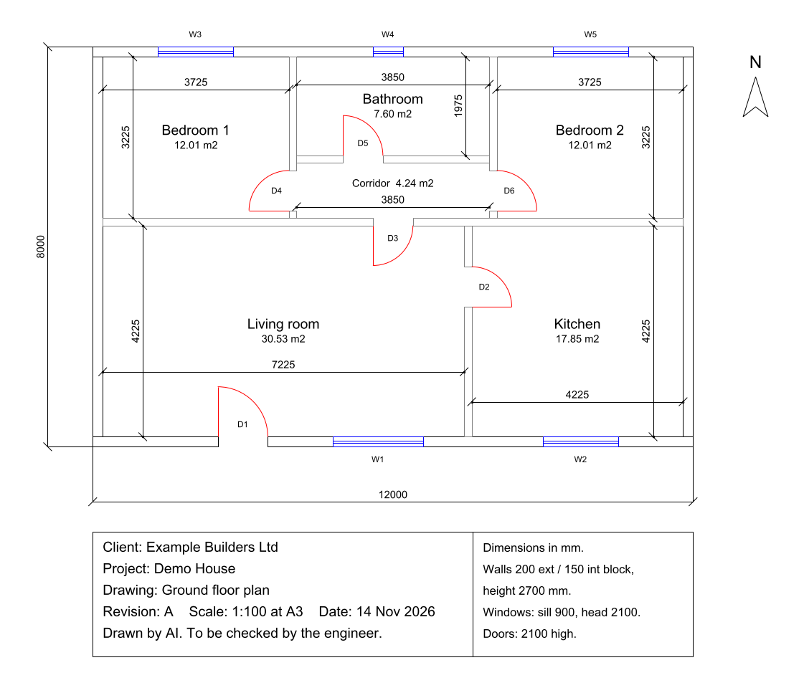
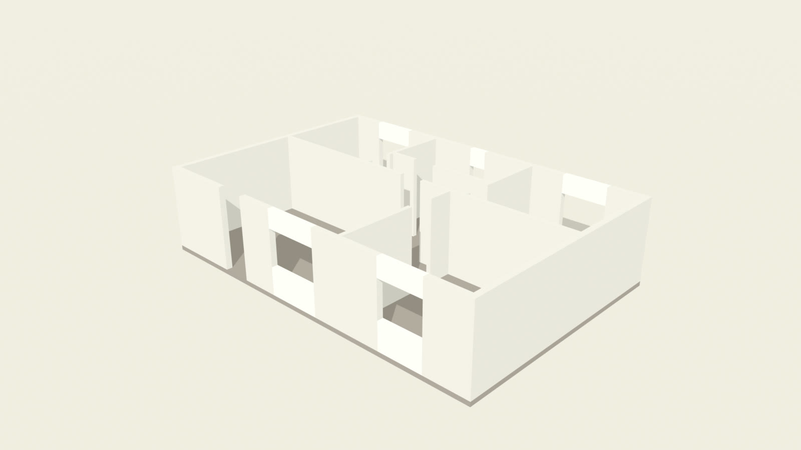

# Fluent CAD

Skills for people who design things on a computer: buildings, parts and products, 3D prints, and the animations that show them off. One install. Say what you want to make and the right skill starts: it sets up your apps, connects your agent to the ones it can drive, does the work, and checks it with numbers and pictures before calling it done.





One brief, "a two-bedroom house, about 12 by 8 m", became the drawing, a room schedule and block count in Excel, this 3D model, a turntable, a walkthrough and a finished video.

## Start here, no terminal needed

1. Install Claude Desktop from [claude.ai/download](https://claude.ai/download) and sign in.
2. Click **Code** at the top and choose a folder for your work. This is Claude working on your computer: it can install your apps and run the scripts.
3. Click **+** next to the prompt box, **Plugins**, **Add marketplace**, type `fluent-ke/fluent-plugins`, and install **Fluent CAD**.
4. Start a new session there and say what you make: "Set up this computer for my work. I'm an architect and I use AutoCAD."

Already use Claude Code in a terminal, or Codex? See [Install](#install).

## Try it

Find your track, then say the line in the middle column.

| You | Say something like | Skills that do it |
|---|---|---|
| **Architecture and building**: architects, draughtspeople, QSs, site engineers, contractors | "Draw a site office, 10 by 6 m, two offices, a meeting room, a store and a toilet, with the block count." | `drawing-building-plans` |
| **Engineering and product design**: mechanical and product designers, students | "Design a wall bracket for a 5 kg shelf in FreeCAD so I can watch." | `designing-3d-models` |
| **3D printing and making**: makers, printer owners, print shops, schools | "Make a keychain from my logo with an NFC tag inside, ready for my Bambu A1." | `designing-3d-models`, `printing-3d-models` |
| **3D animation and visualisation**: Blender artists, motion designers, arch-viz | "Turn this plan into a walkthrough video, then cut it with the drawing and a turntable." | `animating-in-blender` |
| **Everyone, first** | "Set up this computer for my work. I'm an architect and I use AutoCAD." | `setting-up-cad-apps` |

Many people sit in two tracks: an engineer who prints parts uses tracks 2 and 3; arch-viz uses 1 and 4.

## The five skills

- **setting-up-cad-apps**: checks what the computer has, installs the apps that fit the job, and connects the agent to Blender, Fusion, SketchUp, ArchiCAD, Revit or FreeCAD.
- **drawing-building-plans**: a brief in plain words becomes a layered AutoCAD drawing (DXF) with room, door and window schedules and wall quantities in Excel. A separate script measures the drawing to check them. It also takes off quantities from your own drawings and raises a plan into a 3D model.
- **designing-3d-models**: parts in FreeCAD (live, on your screen), Fusion, OpenSCAD or Blender scripts; logos into 3D objects; editing STLs; press moulds; mechanisms such as spring-return levers and gimbal holders; mesh checks; pockets for NFC tags, magnets and nuts.
- **printing-3d-models**: slicer projects in Bambu Studio, OrcaSlicer, PrusaSlicer or Cura, multi-colour prints, pauses for inserts, fine parts, the first layer, and a safety gate for driving a real Bambu printer.
- **animating-in-blender**: turntables and building walkthroughs rendered from any model, and clips, stills and music cut into one video in Blender's Video Sequencer, with the `.blend` handed back so you can keep editing.

## Where they work

The skills run scripts and apps on your own computer, so they need an agent that works there.

| App | What works |
|---|---|
| Claude Code: the **Code** tab in Claude Desktop (no terminal needed), the terminal, IDE extensions | Everything |
| Codex: CLI, desktop app, IDE extension | Everything |
| Claude Desktop with connectors | Live work in Blender, Fusion, SketchUp and ArchiCAD through their connectors, plus advice |
| Claude chat on the web and Cowork | Advice, scripts and the SketchUp connector. Code there runs in a sandbox, not on your computer, so it can't reach your apps |

## What it runs, sends and fetches

- **Installs only with your yes.** `setting-up-cad-apps` shows each install command before running it, using your computer's own package manager (Homebrew, winget or Flatpak) or the app's official download page. Paid apps you install and sign in to yourself.
- **Drawing scripts fetch their libraries.** `uv` downloads the open-source ezdxf, matplotlib and openpyxl from PyPI the first time the scripts run.
- **Connections stay on your computer.** The FreeCAD, Blender, Fusion, ArchiCAD and Revit connections listen only on your own machine. The SketchUp connector runs in Trimble's cloud under your Trimble ID and receives the model descriptions you give it.
- **Nothing goes to Fluent.** No analytics or telemetry. Feedback is yours to send: with Fluent AI Skills installed, its `about-fluent` skill gives you a prefilled form link and sends nothing itself.

See the [privacy policy](https://github.com/fluent-ke/fluent-plugins/blob/main/PRIVACY.md).

## Install

Open Claude Code or Codex and paste:

> Install the Fluent CAD plugin by following https://github.com/fluent-ke/fluent-plugins/blob/main/plugins/fluent-cad/INSTALL.md

The agent installs the plugin and checks it worked. Or run it yourself in Claude Code:

```
/plugin marketplace add fluent-ke/fluent-plugins
/plugin install fluent-cad@fluent
```

On claude.ai, the desktop app and Cowork: **Customize → Plugins**. Codex and other agents: see [INSTALL.md](INSTALL.md). Then start a new session and say what you make. [GUIDE.md](GUIDE.md) has a first project for each track.

## What's inside

```
skills/setting-up-cad-apps/
  scripts/check_setup.py              read-only report of CAD, 3D and print apps and agent bridges
  references/connectors.md            Blender, Fusion, SketchUp, ArchiCAD, Revit and AutoCAD connections
  references/freecad-mcp.md           connect any agent to FreeCAD
skills/drawing-building-plans/
  scripts/example_house_plan.py       worked example: a two-bedroom house, drawing + workbook from one set of data
  scripts/measure_dxf.py              measures any DXF by layer: areas, lengths, block counts, texts, a PNG
  scripts/extrude_walls.py            raises a plan's walls into a 3D model for viewing
  references/quantities.md            wall areas, openings and block counts, with a worked example
skills/designing-3d-models/           FreeCAD bridge client, export gate, Blender render, NFC example;
                                      references for Blender scripting, press moulds and mechanisms
skills/printing-3d-models/            Bambu Studio project builder, slicer notes, Bambu printer safety gate
skills/animating-in-blender/
  scripts/animate_model.py            turntable or walkthrough, still or full video, saves the .blend
  scripts/edit_video.py               clips, stills and music into one video in Blender's Video Sequencer
```

## Safety

- Drawings say "Drawn by AI. To be checked by the engineer." The agent never claims a design meets building regulations.
- Quantities are formulas you can audit, and the drawing is measured separately to check them.
- Connectors run code the agent writes inside your app. Save first; the agent asks before bulk changes.
- You start every print. The agent touches a printer only when you ask, and names the printer, action and file first.
- Passwords, licences and printer access codes stay with you.

## Tested

On macOS with Blender 5.2.1, FreeCAD 1.1.3 and Bambu Studio 02.08. `measure_dxf.py` reproduced the wall areas of two independently drawn plans exactly (AutoCAD 2010 and R12 DXF). `animate_model.py` and `edit_video.py` rendered a turntable, a walkthrough and a three-shot edit with music. A fresh agent given only the skills and the house brief above produced the drawing, workbook, 3D model, turntable, walkthrough and a 19-second edit in about 10 minutes, and every measured wall and room area agreed with its workbook. The gaps it reported were fixed, except three known limits: doors stay open to full height in the 3D model, `measure_dxf.py` does not read dimension values, and walkthrough wall clearance is checked by the agent rather than a script. The connectors' steps follow the vendors' pages as of November 2026 and have not been run end to end here. Windows and Linux have not been run, nor have the OrcaSlicer, PrusaSlicer and Cura steps, the AutoLISP route, or the claude.ai sandbox route. For a live session, demo on a tested Mac and treat Windows as best effort. If something fails, open an issue with what you asked, what happened and the output of `check_setup.py`.

## Credits

The Blender-scripting, press-mould, mechanism-design and Bambu printer-safety guidance was contributed by [Samwel Tinega](https://github.com/Samwel-Momoima-Tinega) from his project work ([3d-design-and-printing](https://github.com/Samwel-Momoima-Tinega/3d-design-and-printing)).

## Licence

[MIT](../../LICENSE).
